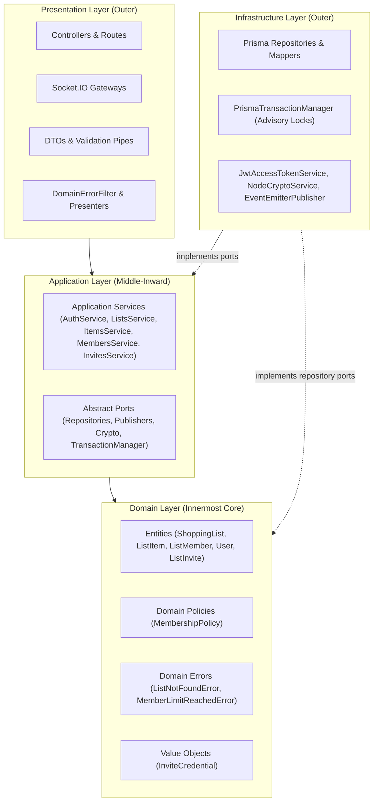
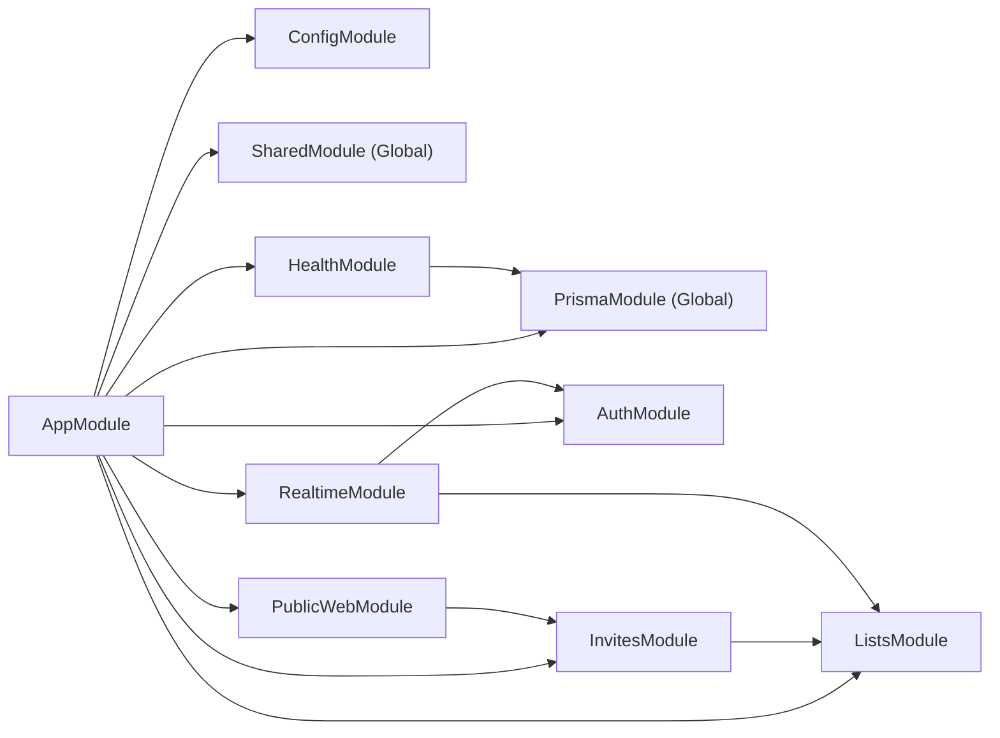

# Architecture Documentation — Listix Worker

> Comprehensive architectural guide and system review for the `listix-worker` backend service, built with **NestJS**, **PostgreSQL (Prisma)**, and **WebSockets (Socket.IO)** in accordance with **Clean Architecture** principles and [AGENTS.md](file:///c:/Users/jmena/Documents/Personal-projects/Listix-project/listix-worker/AGENTS.md).

---

## 1. System Overview

**Listix** is an offline-first collaborative shopping list application. Each client device maintains a complete local database and functions autonomously without internet connectivity. The backend service (`listix-worker`) is engaged primarily when lists are shared among members, fulfilling four core duties:

1. **Anonymous Identity Management**: Seamless user identification without registration forms, utilizing cryptographically secure anonymous accounts backed by JWT access tokens and rotatable refresh tokens.
2. **Deterministic State Synchronization**: Last-Write-Wins (LWW) conflict resolution across lists and items, preserving distributed consistency while respecting monotonic clock ordering.
3. **Sharing & Invitation Lifecycle**: Cryptographically secure token/code generation, rate-limited validation, atomic member joining with strict member caps (max 5 members), and concurrency control via PostgreSQL transaction-level advisory locks.
4. **Realtime Broadcasts**: Emitting domain events over Socket.IO to keep connected clients immediately synchronized.

---

## 2. Clean Architecture Core Principles

The codebase strictly adheres to **Clean Architecture (Hexagonal / Ports & Adapters)**. All source code dependencies point **inward** toward the core domain logic:



### 2.1 Layer Constraints & Responsibilities

| Layer | Directory | Responsibilities | Constraints |
| :--- | :--- | :--- | :--- |
| **Domain** | `src/modules/*/domain`<br/>`src/shared/domain` | Enterprise business entities, domain invariants, value objects, domain errors, and repository port definitions. | **Zero framework dependencies.** Plain TypeScript only. Never imports `@nestjs/*`, `@prisma/client`, or HTTP libraries. |
| **Application** | `src/modules/*/application`<br/>`src/shared/application` | Application services orchestrating business workflows (`AuthService`, `ListsService`, `ItemsService`, `MembersService`, `InvitesService`) and outbound port contracts (`abstract class`). | Depends only on Domain and Ports. Framework-agnostic business workflows. |
| **Infrastructure** | `src/modules/*/infrastructure`<br/>`src/shared/infrastructure` | Adapters for persistence (Prisma), cryptography (`node:crypto`), token signing (`@nestjs/jwt`), and in-memory event dispatching. | Implements Application and Domain ports. Maps Prisma database records to pure Domain entities. |
| **Presentation** | `src/modules/*/presentation`<br/>`src/shared/presentation` | NestJS controllers, WebSocket gateways, DTOs with `class-validator`, guards (`JwtAuthGuard`, `ThrottlerGuard`), filters, and presenters. | Translates incoming HTTP/WS payloads to use case inputs; formats use case outputs into HTTP view models. |

### 2.2 Why Abstract Classes for Ports?

In TypeScript, `interface` contracts are erased during compilation, preventing NestJS from using them as Dependency Injection (DI) tokens without string literal markers (`@Inject('PORT_TOKEN')`). 

Instead, ports are declared as TypeScript `abstract class`es:
```typescript
// Outbound Port (Domain or Application layer)
export abstract class ListRepository {
  abstract findById(id: string): Promise<ShoppingList | null>;
  abstract save(list: ShoppingList): Promise<void>;
}

// Composition Root (NestJS Module)
{ provide: ListRepository, useClass: PrismaListRepository }
```
This achieves pure architectural decoupling while retaining first-class NestJS constructor type-injection without decorator boilerplate.

---

## 3. Architecture Review & Diagnostic Scorecard

Applying the **Clean Architecture Quick Diagnostic** (as detailed in the `clean-architecture` skill):

| # | Diagnostic Check | Status | Verification & Evidence |
| :-: | :--- | :-: | :--- |
| 1 | **Dependency Rule holds** | ✅ PASS | All imports point inward. Domain modules contain 0 imports of `@nestjs/*`, `@prisma/client`, or outside adapters. |
| 2 | **Entities encapsulate critical business rules** | ✅ PASS | `ShoppingList.markDeleted()`, `ListItem.applyChanges()`, `MembershipPolicy.assertCanChangeRole()`, `ListInvite.assertUsableAt()`. |
| 3 | **Use cases orchestrate single operations** | ✅ PASS | Each use case is a dedicated class with a single `execute()` method (`JoinList`, `SyncList`, `CreateInvite`, etc.). |
| 4 | **Request/Response boundaries** | ✅ PASS | DTOs validate incoming data; Use cases receive command objects and return domain entities or result models; Presenters convert them to HTTP responses. |
| 5 | **Repositories defined inward, implemented outward** | ✅ PASS | Domain defines `abstract class ListRepository`; Infrastructure implements `PrismaListRepository`. |
| 6 | **Database and frameworks are details** | ✅ PASS | Prisma is strictly confined to `infrastructure/` and `prisma.service.ts`. Swapping Prisma for another ORM would not touch domain or application logic. |
| 7 | **Delivery mechanism independent** | ✅ PASS | Use cases can be driven identically by HTTP controllers, WebSocket handlers, or CLI commands. |

**Score: 10 / 10** (Full Clean Architecture compliance).

---

## 4. Request Lifecycle & Concurrency Control

```mermaid
sequenceDiagram
    autonumber
    participant Client
    participant Middleware as Middleware (Helmet, CORS)
    participant Guard as Guards (JwtAuthGuard, ThrottlerGuard)
    participant Pipe as ValidationPipe
    participant Controller as Presentation Controller
    participant UseCase as Application Use Case
    participant TxMgr as PrismaTransactionManager
    participant DB as PostgreSQL
    participant EventPub as ListEventPublisher
    participant Filter as DomainErrorFilter

    Client->>Middleware: HTTP Request
    Middleware->>Guard: Process
    Guard->>Pipe: canActivate() = true
    Pipe->>Controller: Validated DTO
    Controller->>UseCase: execute(command)
    UseCase->>TxMgr: run(work, { lockKey: listId })
    TxMgr->>DB: BEGIN & pg_advisory_xact_lock(hash(listId))
    UseCase->>DB: Query & Mutate via Repository
    TxMgr->>DB: COMMIT & Lock Release
    UseCase->>EventPub: publish(ListChangedEvent)
    UseCase-->>Controller: Domain Result
    Controller-->>Client: 200 OK (Formatted via Presenter)

    Note over UseCase,Filter: On DomainError: Transaction rolls back; DomainErrorFilter catches and maps error code to HTTP status
```

### 4.1 Transaction-Level Advisory Locking

When multiple concurrent operations target the same list (such as two users accepting the 5th invitation slot simultaneously, or concurrent item modifications), standard row locking can cause deadlocks or race conditions.

Listix uses PostgreSQL transaction-scoped advisory locks:
- Call: `SELECT pg_advisory_xact_lock(hashtextextended($1, 0))` keyed on `listId`.
- **Serialization per List**: All writes to the same list are strictly serialized.
- **Independence across Lists**: Operations on distinct lists run with full database concurrency without blocking each other.
- **Non-blocking Reads**: Read-only queries (snapshots) do not acquire locks and execute uninhibited.

---

## 5. Module Structure & Cross-Module Boundaries



### 5.1 Module Directory Layout

```text
src/
├── app.module.ts              # Root composition root
├── app.setup.ts               # Global pipes, filters, security headers
├── main.ts                    # Application entry point
├── config/
│   └── env.schema.ts          # Zod schema validation for environment variables
├── shared/                    # Shared Kernel
│   ├── domain/                # Clock, Time utilities, DomainError base
│   ├── application/           # CryptoService, TransactionManager ports
│   ├── infrastructure/        # NodeCryptoService, SystemClock, PrismaService
│   └── presentation/          # DomainErrorFilter, ErrorStatusMap
└── modules/
    ├── auth/                  # Anonymous identity & session management
    │   ├── domain/            # User, RefreshToken, Auth errors, Repositories
    │   ├── application/       # AuthService, AccessTokenService, SessionIssuer
    │   ├── infrastructure/    # JwtAccessTokenService, Prisma repos
    │   └── presentation/      # AuthController, JwtAuthGuard, CurrentUser decorator
    ├── lists/                 # Lists, items, and memberships
    │   ├── domain/            # ShoppingList, ListItem, ListMember, MembershipPolicy
    │   ├── application/       # ListsService, ItemsService, MembersService, ListAccessService
    │   ├── infrastructure/    # Prisma repos, EventEmitterListEventPublisher
    │   └── presentation/      # ListsController, ItemsController, MembersController
    ├── invites/               # Sharing links, codes, and joining
    │   ├── domain/            # ListInvite, InviteCredential, Invite errors
    │   ├── application/       # InvitesService, InviteFinder
    │   ├── infrastructure/    # PrismaInviteRepository
    │   └── presentation/      # InvitesController, ListInvitesController
    ├── realtime/              # WebSockets (Socket.IO)
    │   └── presentation/      # ListsGateway (list:subscribe, list.changed)
    ├── public-web/            # Web landing and deep link fallback
    │   └── presentation/      # InviteLandingController, InviteLandingPage
    └── health/                # Terminus liveness and DB probe
        └── health.controller.ts
```

---

## 6. Application Services Catalog & Conventions

In adherence to [AGENTS.md](file:///c:/Users/jmena/Documents/Personal-projects/Listix-project/listix-worker/AGENTS.md), business workflows are organized into cohesive **Application Services** per aggregate or domain area:

| Service | File | Operations Orchestrated |
| :--- | :--- | :--- |
| **`AuthService`** | `auth.service.ts` | `signInAnonymously()`, `refreshSession()`, `getCurrentUser()` |
| **`ListsService`** | `lists.service.ts` | `findMine()`, `sync()`, `getSnapshot()`, `delete()` |
| **`ItemsService`** | `items.service.ts` | `upsert()`, `delete()` |
| **`MembersService`** | `members.service.ts` | `changeRole()`, `remove()` |
| **`InvitesService`** | `invites.service.ts` | `create()`, `revoke()`, `validate()`, `join()` |

---

## 7. Compliance with AGENTS.md Guardrails

1. **No Automatic Staging or Commits**: All edits and new documentation remain unstaged in the working directory for manual inspection.
2. **Platform & Store Agnostic**: 
   - No Android package names or iOS bundle identifiers are required by the core API.
   - Deep links use generic scheme formatting (`${APP_SCHEME}://join/${credential}`) with HTML copy-code fallbacks on `/join/:credential`.
3. **Decorator Metadata & Isolated Modules (`isolatedModules: true`)**:
   - `import type` is systematically used for pure types and interfaces in decorated classes (`@Req()`, `@Res()`, `@CurrentUser()`).
4. **Conventional Commits Ready**: Commit guidelines documented for subsequent user-directed commits.
